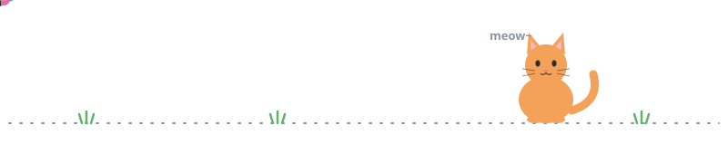

---

### 👋 About

I'm a final-year BCA student from Nepal who builds mobile apps and designs the interfaces they live in.

- 📱 Building cross-platform apps with **Flutter & Dart**
- 🎨 Designing in **Figma** before writing a line of code
- 🎯 Currently sharpening problem-solving and core programming fundamentals

---

### 🚀 Featured Projects

| Project | Description | Stack |
| :-- | :-- | :-- |
| [**🌦️ Weather App**](https://github.com/Swosti-Makaju/Weather_App) | Live weather at a glance | `Flutter` `Dart` |
| [**📝 Notes App**](https://github.com/Swosti-Makaju/Notes_App) | Simple, fast note taking | `Flutter` `Dart` |
| [**📚 Library Management System**](https://github.com/Swosti-Makaju/Library-Management-System) | Manage books, members and records | `PHP` `MySQL` |
| [**🚗 Vehicle Rental System**](https://github.com/Swosti-Makaju/Vehicle-II) | Browse and book vehicles | `PHP` `MySQL` |
| [**🛒 WordPress eCommerce Site**](https://github.com/Swosti-Makaju/wordpress-ecommerce-site) | Full online store | `WordPress` |
| [**🌐 Portfolio**](https://github.com/Swosti-Makaju/My-Portfolio) | My personal site | `HTML` `CSS` |

---

<b>🛠️ Tech Stack</b> &nbsp;<i>(click to expand)</i>

 

**Mobile & Design**

**Languages**

**Web & Database**

**Tools**

<b>📊 GitHub Stats</b> &nbsp;<i>(click to expand)</i>

 

---

### 🎯 Goals

- Level up problem-solving every week
- Learn something new every day

---

**Let's build something good together.**

